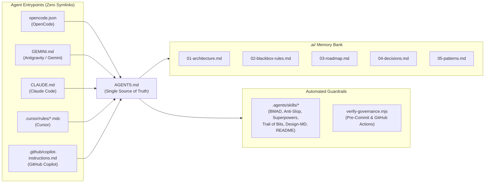

# Blueprint

[](https://github.com/SolidStateNetwork/Blueprint/actions/workflows/governance.yml)
[](init-project.mjs)
[]()

Cross-platform project template that gives **OpenCode**, **Antigravity / Gemini CLI**, **Claude Code**, **Cursor**, **OpenAI Codex**, and **GitHub Copilot** one shared architecture memory bank (`.ai/`), automated skill provisioning, and pre-commit governance checks — without OS symlinks or runtime dependencies.

---

## Quickstart

1. Click **Use this template** → **Create a new repository** on GitHub and clone your new repo.
2. Open the project in your AI coding agent (**OpenCode**, **Antigravity**, **Claude Code**, or **Cursor**) and type in chat:

```text
init
```
*(Or pass your brief directly: `init: Build a Python FastAPI service with PostgreSQL and Redis`)*

### What `init` does automatically
1. Runs `node init-project.mjs` if `.env` or `.agents/skills/` are not set up yet.
2. Sets your repository folder name in `.ai/01-architecture.md` and installs the local `.git/hooks/pre-commit` check.
3. Interviews you (3 short questions) or uses your brief to populate `.ai/01-architecture.md`, `.ai/05-patterns.md`, and `.ai/03-roadmap.md`.
4. **If your project includes a UI/frontend:** helps you pick a design system from [getdesign.md](https://getdesign.md/) or [shadcn.io](https://www.shadcn.io/), or generates a 17-section `DESIGN.md` (v2 format) via `design-md-generator`.

---

## How It Works



---

## Supported AI Agents

| Agent | Native Entrypoint | Loaded Context & MCP Config |
| :--- | :--- | :--- |
| **OpenCode** | `opencode.json` + `AGENTS.md` | Auto-loads `AGENTS.md`, `.ai/*.md`, Context7 & Task Master MCP |
| **Antigravity / Gemini CLI** | `GEMINI.md` (`@AGENTS.md`) | Imports `AGENTS.md` + enforces `.ai/01` through `05` |
| **Claude Code** | `CLAUDE.md` + `.mcp.json` | Points to `AGENTS.md`, `.ai/`, Context7 & Task Master MCP |
| **Cursor** | `.cursor/rules/core-governance.mdc` & `antislop.mdc` | Always-on rules for `.ai/`, `AGENTS.md`, and Anti-Slop (`during` mode) |
| **OpenAI Codex** | `AGENTS.md` | Reads root `AGENTS.md` and `.agents/skills/` natively |
| **GitHub Copilot** | `.github/copilot-instructions.md` | Enforces `AGENTS.md` and `.ai/` memory sync |

---

## Provisioned Skills & MCP Tooling (`init-project.mjs`)

The template repository itself contains **0 dependencies** and **0 bundled third-party folders**. Running `node init-project.mjs` (or typing `init` in chat) installs all skills as real file copies (`--copy`, no Windows symlink issues):

| Tool / Skill Pack | Source | Purpose in Workflow |
| :--- | :--- | :--- |
| **BMAD-METHOD** | `bmad-code-org/BMAD-METHOD` | Agile architecture, PRD breakdown, and sprint workflows (`/architect`, `/pm`, `/dev`) |
| **Anti-Slop (6 Skills)** | `miqdadbadjuber/anti-slop` | Preconfigured in `during` mode to filter generic AI UI (`antislop-ui`), hype copy (`antislop-copywriting`), a11y gaps (`antislop-human`), broken mobile reflow (`antislop-layoutmobile`), and banner comments (`antislop-code`) |
| **Design-MD-Generator v2** | `jasonhnd/design-md-generator` | Generates or extracts 17-section `DESIGN.md` v2 specifications (paired with [getdesign.md](https://getdesign.md/) & [shadcn.io](https://www.shadcn.io/)) |
| **Frontend Design** | `anthropics/skills` | Official Anthropic skill (`frontend-design`) for implementing UI components |
| **Security Guardrails** | `trailofbits/skills` | `sharp-edges` (prevent API footguns & insecure defaults), `differential-review` (audit git diffs), `supply-chain-risk-auditor` (vet dependencies) |
| **Superpowers Engineering** | `obra/superpowers` | `systematic-debugging` (root-cause first), `test-driven-development`, `verification-before-completion` |
| **Beautify GitHub README** | `oil-oil/beautify-github-readme` | Automatically loaded whenever `README.md` is created or edited |
| **Context7 MCP** | `@upstash/context7-mcp` | Live, version-accurate official documentation for any language/library (no API key required) |
| **Claude Task Master** | `task-master-ai` | Task breakdown and roadmap tracking via MCP (`.mcp.json` & `opencode.json`) |

---

## CLI Commands

| Command | Description |
| :--- | :--- |
| `node init-project.mjs` | Initializes `.env`, Git pre-commit hook, all local skills, and Task Master |
| `node init-project.mjs --update` | Updates all installed skills (`BMAD`, `anti-slop`, `superpowers`, `trailofbits`, etc.) to their latest release |
| `node init-project.mjs --skip-tools` | Lightweight setup: creates `.env`, project name, and pre-commit hook without downloading external skills |
| `node verify-governance.mjs` | Verifies `.ai/` files, blocks tracked `.env` or hardcoded API keys, checks for `TODO: implement later` stubs, merge conflicts, and file length limits |

---

## Repository Structure

```text
Blueprint/
├── .ai/
│   ├── 01-architecture.md          # System overview, tech stack & module boundaries
│   ├── 02-blackbox-rules.md        # Module isolation, security & Anti-Slop rules
│   ├── 03-roadmap.md               # Active milestone & task tracking
│   ├── 04-decisions.md             # Architecture Decision Records (ADR)
│   └── 05-patterns.md              # Concrete reference code patterns (< 300 lines/file)
├── .cursor/rules/
│   ├── core-governance.mdc         # Always-on Cursor governance & README trigger
│   └── antislop.mdc                # Always-on Cursor Anti-Slop pointer ("during" mode)
├── .github/
│   ├── workflows/governance.yml    # Automated CI check running verify-governance.mjs
│   ├── PULL_REQUEST_TEMPLATE.md    # Governance & verification checklist for PRs
│   └── copilot-instructions.md     # GitHub Copilot instructions
├── AGENTS.md                       # Single Source of Truth + "init" chat trigger
├── CLAUDE.md                       # Claude Code entrypoint
├── GEMINI.md                       # Gemini CLI / Antigravity entrypoint (@AGENTS.md)
├── opencode.json                   # OpenCode entrypoint (.ai/*.md + MCP servers)
├── .mcp.json                       # MCP config (Context7 + Task Master)
├── init-project.mjs                # Cross-platform project & skill initializer
└── verify-governance.mjs           # Zero-dependency governance & secret verifier
```
